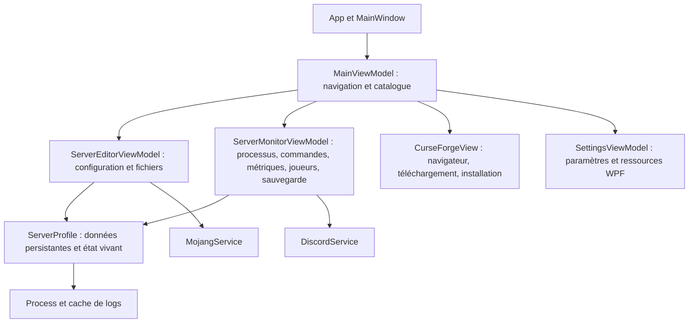
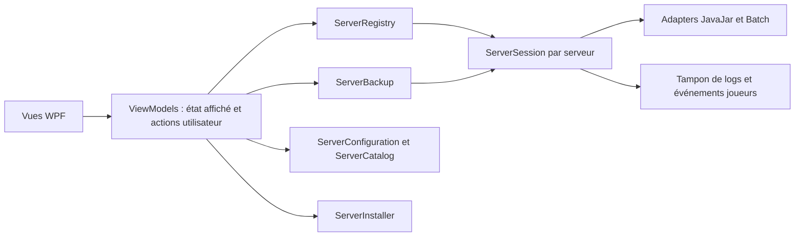

# Analyse et proposition de refactor — Minecraft Servers Manager

Audit du 10 septembre 2026, commit `1980935`. Le code applicatif est inchangé ; ce dossier contient l'analyse et ses reproductions.

**Conclusion.** Le produit a une intention claire et un périmètre cohérent : rendre l'exploitation de plusieurs serveurs Minecraft locaux accessible depuis une application Windows. Son principal besoin est de fiabiliser l'exécution en arrière-plan. Le cycle de vie d'un serveur appartient actuellement à un ViewModel recréé à chaque navigation, alors que le processus Java continue de vivre. Cette différence de durée de vie explique plusieurs défauts de redémarrage, d'état et de suivi des joueurs. La sauvegarde présente également des défauts de fiabilité démontrés. Je recommande une extraction progressive des responsabilités métier, en conservant WPF et les parcours existants.

**Périmètre et méthode.** Lecture des 29 fichiers C# suivis, des 14 fichiers XAML, du projet, du README et du profil de publication local. Compilation de l'application et reproductions ciblées sur son assembly. Le dépôt était initialement propre. La compilation `dotnet build "Minecraft Server Manager.csproj" --no-restore --nologo -v:minimal` réussit avec **238 avertissements, 0 erreur** ; les compilations temporaires WPF répètent une partie des diagnostics. Aucun projet de tests ni workflow CI suivi par Git n'a été trouvé.

Les reproductions utilisent des profils synthétiques, des fichiers temporaires et des objets WPF sans ouvrir de fenêtre. Aucun serveur Minecraft ni téléchargement réel n'a été lancé, aucun webhook n'a été envoyé. Les performances n'ont pas été profilées sous charge réelle. Les scénarios qui nécessitent plusieurs serveurs Java, un crash réel ou des téléchargements CurseForge restent à valider en intégration.

## Ce que le projet cherche à faire

| Parcours | Comportement réellement implémenté | Limite actuelle |
|---|---|---|
| Tableau de bord | Plusieurs profils, icônes, état, compteur de joueurs ; sélection d'un serveur | Les indicateurs dépendent de l'état partagé avec le monitoring |
| Ajout d'un serveur | Choix d'un dossier contenant déjà `server.properties` et `eula.txt` | L'ajout ne crée pas un serveur vanilla vierge et n'installe pas Java |
| CurseForge | WebView2, interception des ZIP dont le nom contient `Server`, extraction et création d'un profil | La détection repose sur le nom du fichier et une heuristique de JAR ; l'extraction ne garantit pas un serveur démarrable |
| Exécution | `java … -jar … nogui` ou script batch modifié, entrée/sorties redirigées | Pas de propriétaire stable du processus indépendant de l'écran |
| Monitoring | CPU, mémoire résidente, durée, console colorée, historique de commandes, joueurs extraits des logs | Le processus mesuré en mode batch est `cmd.exe` ; la liste de joueurs ne survit pas à la navigation |
| Configuration | Nom, icône, Java, arguments, propriétés serveur, whitelist, opérateurs | Mélange de modifications immédiates en mémoire, écritures immédiates sur disque et bouton Enregistrer |
| Automatisation | Redémarrage quotidien et relance après arrêt considéré comme crash ; notifications Discord | Planification liée au timer du ViewModel affiché ; aucune politique d'annulation/backoff complète |
| Sauvegarde | ZIP manuel dans `Backups`, purge des ZIP de plus de sept jours à la création suivante | Pas de parcours de restauration, de liste ou de suppression manuelle des sauvegardes dans le code examiné |
| Application | Instance unique, fermeture vers la zone de notification, sortie avec tentative d'arrêt collectif | L'arrêt collectif concurrence la logique de relance des ViewModels |
| Présentation | Cinq thèmes, quatre langues | 144 clés identiques par langue, mais certains messages sont encore codés en français |

Le README présente donc une ambition un peu supérieure à l'implémentation : la création automatique complète et le gestionnaire de sauvegardes sont à préciser. Son prérequis « .NET 6.0 ou supérieur » ne décrit pas correctement le projet ciblant `net9.0-windows`. Le profil de publication présent localement prévoit un exécutable autonome `win-x64`, mais il n'est pas suivi par Git.

## Architecture actuelle



L'organisation suit les noms du MVVM, mais les ViewModels réalisent directement l'orchestration des processus et des fichiers. `ServerMonitorViewModel` représente 900 lignes et `ServerEditorViewModel` 665 lignes, soit environ 41 % du C# suivi. Le problème est surtout le nombre de responsabilités et leur durée de vie.

`ServerProfile` cumule données JSON, `Process`, verrou implicite sur `StringBuilder`, événements de logs, état d'exécution et images WPF. Le modèle ne peut donc pas servir simplement de contrat de stockage ou de domaine indépendant de l'interface graphique. Les deux petits modules HTTP sont, à l'inverse, déjà isolés, mais statiques et peu observables.

Les bonnes bases à conserver sont les commandes et liaisons WPF, les dictionnaires de langue cohérents, les `HttpClient` partagés, les brushes gelées, le cache d'icône, le cache de logs borné et le déplacement d'une partie des opérations longues hors du thread graphique.

## Corrections prioritaires

`P1` : risque sur les données ou une fonction centrale ; `P2` : comportement incorrect ou robustesse insuffisante ; `P3` : maintenance et confort. « Reproduit » désigne les sondes livrées ; « déduit » désigne un chemin explicite dans le code qui n'a pas été exécuté de bout en bout.

**F1 — P1 : la navigation change le fonctionnement du serveur.**

Références : [changement de vue](../ViewModels/MainViewModel.cs#L43), [initialisation et nettoyage du monitoring](../ViewModels/ServerMonitorViewModel.cs#L193), [planification](../ViewModels/ServerMonitorViewModel.cs#L676), [événement de sortie](../ViewModels/ServerMonitorViewModel.cs#L387).

`Cleanup()` arrête le timer et retire l'abonnement aux logs ; l'événement `Process.Exited` conserve cependant le ViewModel ayant démarré le processus. Une nouvelle visite crée un autre ViewModel avec ses propres indicateurs `_isIntentionalStop` et `_isRestarting` et son propre verrou de commandes.

- Reproduit : un joueur apparaît avant navigation ; au retour, le nouveau monitoring annonce zéro joueur alors que le profil conserve un compteur à un. Les logs reçus entre-temps existent dans le cache mais ne reconstruisent pas la liste.
- Reproduit : le timer du premier monitoring s'arrête lors du nettoyage. Le redémarrage quotidien se trouvant dans ce timer, il cesse d'être vérifié lorsque l'utilisateur quitte le monitoring pour l'accueil, les paramètres ou un autre serveur.
- Déduit : démarrer A, quitter sa vue, revenir puis arrêter A positionne l'intention d'arrêt dans le nouveau ViewModel. L'ancien reçoit `Exited`, interprète la sortie comme un crash et peut relancer A.
- Reproduit : si le nouveau monitoring s'ouvre pendant une opération occupée, son interrupteur reste désactivé après `profile.IsBusy = false` ; cette propriété ne notifie pas ses changements.
- Reproduit : disposer le verrou alors qu'une commande le détient fait échouer son `Release()` avec `ObjectDisposedException`. Dans le code, ce `Release()` est dans le `finally` d'une méthode `async void`.

Correction : un module `ServerSession` unique par serveur, conservé indépendamment des vues, possède le processus, ses abonnements, ses commandes, son état et ses tâches. Une vue se désabonne de la session sans détruire la session.

**F2 — P1 : l'arrêt collectif et la suppression peuvent perdre le contrôle d'un processus.**

Références : [arrêt collectif](../ViewModels/MainViewModel.cs#L292), [suppression](../ViewModels/MainViewModel.cs#L257), [relance automatique](../ViewModels/ServerMonitorViewModel.cs#L535), [fermeture](../MainWindow.xaml.cs#L99).

L'arrêt collectif écrit directement `stop` sans établir l'intention d'arrêt dans le propriétaire de `Exited` et sans annuler les délais de relance. Avec plusieurs serveurs, la relance à dix secondes peut se produire pendant l'attente de quinze secondes d'un autre serveur. Il existe aussi deux chemins concurrents de libération du `Process`.

La suppression d'un profil actif retire immédiatement celui-ci de `Servers`. Le processus continue, mais il ne fait plus partie de l'arrêt collectif. Enfin, cet arrêt filtre par `IsRunning`, un booléen que l'interrupteur peut déjà avoir mis à `false` avant la fin réelle du processus. Ces scénarios sont déduits du code.

Correction : fermeture globale idempotente ; refus des nouveaux démarrages, annulation des relances, puis arrêt de toutes les sessions possédant encore un processus. La suppression doit d'abord terminer la session ou être empêchée tant qu'elle est active. Le délai d'arrêt doit exister aussi pour l'arrêt manuel. En mode batch, gérer explicitement l'arbre de processus et vérifier sa terminaison.

**F3 — P1 : une sauvegarde peut réussir sans sauvegarder les fichiers attendus.**

Référence : [PerformBackup](../ViewModels/ServerMonitorViewModel.cs#L799).

Reproduit sur la méthode applicative : avec un unique fichier `level.dat` synthétique verrouillé, le ZIP créé contient **zéro entrée** et le journal annonce le succès. La cause est le `catch (IOException) { }` par fichier.

L'exclusion `file.FullName.Contains("Backups")` s'applique à l'ensemble du chemin. Un serveur placé sous `C:\Backups\Minecraft` voit ainsi tous ses fichiers exclus. Elle traverse également les dossiers de sauvegarde avant de filtrer les fichiers, au lieu d'élaguer ces sous-arbres.

Pour un serveur actif, `save-off` et `save-all` sont envoyés par des méthodes non attendables, puis une attente fixe de trois secondes remplace la confirmation de sauvegarde. La purge des anciennes archives précède la création et la validation de la nouvelle. La création du dossier de sauvegarde se trouve avant le `try`, après l'activation de l'état occupé.

Correction : module `ServerBackup` avec protocole explicite de préparation de sauvegarde, délai borné et restauration de `save-on` dans un `finally`. La capacité de sauvegarde en ligne doit être vérifiée selon le serveur ; proposer une sauvegarde après arrêt quand la cohérence ne peut pas être garantie. Écrire une archive temporaire, traiter toute omission inattendue comme un échec, vérifier son contenu puis publier le nom final. Exclure le dossier de destination par comparaison de chemins normalisés. Purger uniquement après succès en conservant une dernière archive validée. Le test décisif reste une restauration vérifiée sur un dossier isolé.

**F4 — P1/P2 : les booléens décrivent mal les transitions du processus.**

Références : [IsRunning](../ViewModels/ServerMonitorViewModel.cs#L100), [EULA](../ViewModels/ServerMonitorViewModel.cs#L259), [création du processus](../ViewModels/ServerMonitorViewModel.cs#L378), [traitement de sortie](../ViewModels/ServerMonitorViewModel.cs#L479).

L'interrupteur écrit l'état « en cours » avant le démarrage. Un refus d'EULA quitte la méthode sans remettre cet état à zéro. Un échec de `Process.Start()` laisse un objet `Process` non associé dans le profil ; le prochain `HasExited`, évalué avant le `try`, peut à son tour lever une exception.

Le gestionnaire de sortie dispose le processus à la ligne 505 puis lit `ExitCode` à la ligne 549. Reproduit sur `Process` : cette lecture lève `InvalidOperationException`. Dans l'application, elle empêche l'envoi du webhook de crash situé dans le même `try` et produit le code de repli `-999`.

Le webhook de démarrage part après cinq secondes sans vérifier la disponibilité du serveur. La relance n'a ni budget d'essais ni temporisation progressive. Le redémarrage planifié annonce dix secondes aux joueurs, puis appelle immédiatement l'arrêt.

Correction : états explicites `Stopped`, `Starting`, `Running`, `Stopping`, `RestartPending`, `Faulted`. Le processus démarré et le serveur prêt sont deux observations distinctes. Lire le code de sortie avant libération, identifier chaque génération de processus et ignorer les événements périmés. Toute attente doit être annulable. L'EULA refusée et l'échec de lancement doivent revenir à un état stable.

**F5 — P1/P2 : le mode batch altère les scripts et mesure le mauvais processus.**

Références : [réécriture et lancement](../ViewModels/ServerMonitorViewModel.cs#L328), [mesures](../ViewModels/ServerMonitorViewModel.cs#L633), [sélection du script](../ViewModels/ServerEditorViewModel.cs#L420).

La regex `\bjava\b` remplace aussi les segments `Java` d'un chemin et la partie `java` de `java.exe`. Reproduit : un script contenant `"C:\Program Files\Java\jdk-21\bin\java.exe"` devient une commande avec plusieurs chemins et guillemets imbriqués. Le fichier temporaire fixe peut également écraser un fichier du même nom.

Le processus stocké est `cmd.exe` : CPU et RAM décrivent le shell, et la mort du shell ne prouve pas celle d'un Java détaché par un script. La sélection d'un batch dans un sous-dossier ne conserve que son nom, ce qui perd son emplacement relatif.

Correction : adapter `JavaJar` et adapter `Batch` derrière une interface de lancement commune. Conserver le script ; configurer l'environnement enfant pour les scripts qui respectent `JAVA_HOME`/`PATH`, et signaler explicitement les chemins Java codés en dur. Définir les capacités du mode batch : commandes, mesure du processus enfant, arrêt complet. Les scripts qui détachent le serveur nécessitent un suivi supplémentaire. Ne pas promettre ces capacités à partir du seul PID du shell.

**F6 — P2 : persistance fragile et état temporaire sauvegardé.**

Références : [modèle](../Models/ServerProfile.cs#L86), [stockage des paramètres](../Models/AppSettings.cs#L16), [chargement des profils](../ViewModels/MainViewModel.cs#L166), [enregistrement](../ViewModels/ServerEditorViewModel.cs#L326).

Reproduit : le JSON contient `IsRunning=true` et se recharge avec ce booléen alors que `ServerProcess` est nul. Les écritures utilisent directement `WriteAllText` et plusieurs erreurs sont ignorées. Un JSON illisible disparaît silencieusement de l'interface. Les chemins de profils sont dupliqués. L'ajout ne déduplique pas les dossiers : deux profils peuvent viser les mêmes fichiers de monde.

L'éditeur modifie directement le profil partagé avant Enregistrer ; partir sans sauvegarder laisse un état appliqué en mémoire mais absent du disque. Le fichier de profil peut être enregistré alors que l'enregistrement de `server.properties` échoue ensuite.

Correction : séparer `ServerDefinition` persistée, `ServerSession` vivante et brouillon d'édition. Stockage JSON versionné avec validation, écriture temporaire puis remplacement, conservation d'une version précédente et erreurs affichables. Dédupliquer sur les chemins canoniques en tenant compte de la casse Windows ; traiter les jonctions si elles sont supportées. Centraliser les emplacements sans déplacer silencieusement les données existantes.

**F7 — P2 : console avec pertes de lignes et allocations évitables.**

Références : [file d'affichage](../UserControls/ServerMonitor.xaml.cs#L108), [réémission par ligne](../ViewModels/ServerMonitorViewModel.cs#L706), [cache](../Models/ServerProfile.cs#L174).

Reproduit : 51 lignes injectées donnent 50 paragraphes et une file vide. Dans `while (_logQueue.TryDequeue(out string text) && batchSize < 50)`, le retrait est effectué avant le contrôle de la limite. Inverser ces deux conditions corrige cette perte précise.

La file d'affichage reste non bornée. Chaque ligne crée d'abord une opération Dispatcher, avant d'atteindre la file pourtant destinée à regrouper le rendu. À l'ouverture, l'intégralité du cache est divisée en lignes et transformée en paragraphes, alors que seuls mille paragraphes sont conservés. Le plafond de cinq millions de caractères représente environ dix Mio de contenu UTF-16, avant copies, capacité réservée et éléments WPF.

Correction : tampon circulaire de lignes dans la session, parsing des événements hors du rendu, transfert de lots à l'écran et chargement initial limité aux dernières lignes utiles. Borner les files et signaler les lignes non affichées en cas de surcharge. Préserver la possibilité de consulter un journal sur disque. Conserver les optimisations existantes des brushes.

**F8 — P2 : les permissions ont plusieurs auteurs concurrents.**

Référence : [whitelist et opérateurs](../ViewModels/ServerEditorViewModel.cs#L503).

L'ajout envoie une commande au serveur puis réécrit son fichier JSON depuis une liste chargée précédemment. La suppression fait l'opération inverse et certaines écritures de commande ne sont pas attendues. Une modification par la console ou le serveur peut être écrasée par une liste obsolète. Le verrou du monitoring n'est pas partagé par l'éditeur.

Correction : serveur actif, passer par le canal de commandes sérialisé et réconcilier l'état observé ; serveur arrêté, éditer les fichiers de manière atomique. Distinguer commande envoyée, résultat confirmé et échec. Même principe pour `server.properties` : conserver les commentaires et les lignes non modifiées, préserver la syntaxe/les échappements et signaler les changements externes.

**F9 — P2 : l'installation CurseForge est une extraction optimiste.**

Références : [navigation et messages](../UserControls/CurseForgeView.xaml.cs#L94), [téléchargement](../UserControls/CurseForgeView.xaml.cs#L116), [installation](../UserControls/CurseForgeView.xaml.cs#L215).

La navigation autorise des URL selon leurs sous-chaînes, sans vérifier leur hôte : une URL d'un autre domaine contenant `/download` passe. Le message utilisé comme URL d'icône n'est pas validé par origine, type, schéma ou taille. Microsoft préconise de vérifier l'origine et le contenu des messages WebView2. [Documentation officielle](https://learn.microsoft.com/en-us/microsoft-edge/webview2/concepts/security).

L'installation choisit un JAR par nom, peut sélectionner un installateur ou aboutir à un nom vide et annonce quand même le succès. Un pack contenant uniquement un script de lancement reste configuré par défaut en mode Java. L'extraction n'a ni annulation, ni quota de taille décompressée, ni nettoyage transactionnel. Un échec peut laisser un dossier partiel ; la fenêtre entière est désactivée pendant l'opération.

`ZipFile.ExtractToDirectory` contrôle déjà les entrées qui sortiraient du dossier cible. Les protections à ajouter ici concernent notamment les quotas, les origines et l'atomicité de l'installation. [Contrat .NET](https://learn.microsoft.com/en-us/dotnet/api/system.io.compression.zipfile.extracttodirectory?view=net-9.0).

Correction : séparer la vue WebView2 du module `ServerInstaller`. Employer un dossier temporaire unique par opération, analyser le contenu, présenter/configurer le lancement détecté et publier le dossier final seulement après validation. Gérer une opération annulable sans désactiver l'arrêt des autres serveurs. Limiter les téléchargements d'images et disposer explicitement WebView2 ainsi que ses abonnements.

**F10 — P2/P3 : chemins, ressources et intégrations à terminer.**

- [Cache navigateur](../ViewModels/SettingsViewModel.cs#L187) : son effacement cible `DefaultServerPath/BrowserData`, alors que WebView2 utilise toujours `Documents/Minecraft Servers Manager/BrowserData`. Changer le dossier d'installation fait donc viser le mauvais cache. Prévoir aussi la libération du navigateur avant son nettoyage.
- [Sélection du JAR](../ViewModels/ServerEditorViewModel.cs#L409) : un simple `StartsWith` confond `C:\Servers\Pack` et `C:\Servers\Pack2`. Reproduit : le second chemin devient `2\server.jar` relativement au premier. Utiliser les opérations de chemin avec contrôle des segments.
- [Langues](../ViewModels/SettingsViewModel.cs#L179) : chaque application de langue ajoute un dictionnaire sans remplacer le précédent. L'ouverture des paramètres en ajoute également un. Conserver un dictionnaire de langue actif et une valeur de repli valide dès le démarrage.
- [Affichage du statut](../UserControls/ServerMonitor.xaml#L30) : le binding `ServerStatusText` vise une propriété inexistante, confirmé par réflexion. Le binding WPF ne fait pas échouer la compilation.
- [Preset Aikar](../ViewModels/ServerEditorViewModel.cs#L470) : remplace tous les arguments et impose `-Xms8G -Xmx8G`. Préserver le budget mémoire choisi et les arguments métier ; vérifier la compatibilité des options avec le Java sélectionné. Éviter d'attribuer automatiquement une priorité `High` à chaque serveur sans mesure.
- [HTTP](../Services/DiscordService.cs#L16) : libérer les réponses, contrôler les statuts, borner les délais, rendre les échecs observables. [Mojang](../Services/MojangService.cs#L11) doit distinguer joueur absent, indisponibilité réseau et réponse invalide. Masquer les URL de webhook dans les diagnostics ; leur stockage mérite un emplacement protégé adapté à Windows.

## Refactor proposé

**Découpage cible.** Garder une petite surface d'interface par module et concentrer les invariants derrière elle. Un point de composition explicite suffit au départ ; un conteneur d'injection n'est pas un prérequis.

| Module | Responsabilité et interface attendue | Ce qui en sort |
|---|---|---|
| `ServerSession` | `StartAsync`, `StopAsync`, `RestartAsync`, `SendCommandAsync`, état observable ; processus et commandes sérialisés | Les ViewModels n'accèdent plus à `Process` ni à `StandardInput` |
| `ServerRegistry` | Une session par identifiant/dossier, consultation, fermeture collective | Les sessions survivent à la navigation |
| `ServerBackup` | `CreateAsync`, progression et résultat détaillé ; coordination avec la session | ZIP, préparation du serveur et rétention quittent le monitoring |
| `ServerCatalog` | Chargement, validation et enregistrement des définitions | Un seul format/version de JSON et un seul chemin d'écriture |
| `ServerConfiguration` | Brouillon, validation, sauvegarde ; propriétés et permissions | L'éditeur ne réécrit plus des fichiers dans plusieurs handlers |
| `ServerInstaller` | Analyse d'archive, installation annulable, résultat vérifié | CurseForgeView se limite au navigateur et à la progression |
| `AppPaths` et présentation | Emplacements centralisés ; thème/langue ; commandes asynchrones WPF | Les chemins et ressources ne sont plus reconstruits partout |

Les points de substitution utiles sont le lancement Java/batch, l'horloge pour les redémarrages, le transport HTTP et les opérations de stockage susceptibles d'échouer. Les tests peuvent utiliser des adapters déterministes à ces endroits. Éviter de créer une interface pour chaque petite classe ou une nouvelle couche qui ne fait que transmettre les mêmes appels.



**Invariants de la session.** Une seule transition de démarrage/arrêt s'exécute à la fois. Toutes les commandes, y compris whitelist, sauvegarde et fermeture, passent par le même canal. Chaque sortie est rattachée à une génération de processus. Un arrêt explicite ou une fermeture de l'application annule les relances. La vue dispose uniquement de son abonnement. La planification reste active pour toutes les sessions concernées, même lorsque l'application est masquée ou l'accueil affiché.

Pour éviter un interblocage, la réception de sortie signale la fin du processus sans attendre un verrou que `StopAsync` détient déjà pendant son attente. Le module doit également terminer la lecture des sorties avant de libérer les ressources. La méthode publique de commande peut confirmer une écriture ; une confirmation métier nécessite un protocole supplémentaire, notamment pour les sauvegardes.

**Organisation du dépôt.** Commencer par extraire ces modules dans des dossiers distincts tout en gardant le projet WPF compilable. Quand le cœur n'importe plus WPF, le déplacer dans une bibliothèque `Core` et ajouter un projet de tests. Lors de l'ajout de sous-projets, déplacer l'application sous `src` ou exclure explicitement leurs fichiers du glob `Compile` du projet racine. Le SDK C# inclut autrement les sources des sous-dossiers.

**Persistance et migration.** Introduire un `schemaVersion`. Lire les profils actuels, valider l'identifiant et les chemins, ignorer l'ancien `IsRunning`, puis produire les définitions du nouveau format. Conserver les originaux jusqu'à validation et rendre la migration répétable sans doublons. Distinguer clairement le catalogue de l'application, son cache WebView2 et le répertoire choisi pour installer les serveurs ; ce dernier n'implique pas un déplacement du catalogue.

## Ordre d'implémentation et validation

| Lot | Travail | Critère de sortie |
|---|---|---|
| 1 — Exécution | `ServerSession`, registre, états, commandes attendables, arrêt/relance annulables, protection de suppression | Naviguer puis arrêter ne relance pas le serveur ; quitter pendant une relance ne laisse aucun processus géré actif |
| 2 — Données | Sauvegarde fiable, écritures atomiques, définitions séparées de l'état vivant, permissions | Une lecture impossible interdit le succès ; restauration de fixture vérifiée ; aucun état « running » rechargé du JSON |
| 3 — Installation | Adapters de lancement, détection du pack, validation des chemins/origines, annulation | JAR, script en sous-dossier, chemin avec espaces, installation invalide et annulation couverts |
| 4 — Réactivité et UI | Perte de ligne, lots et files bornées, historique initial limité, état observé, cache et langues | Aucune perte silencieuse ; affichage borné sous charge ; navigation et opérations occupées récupèrent correctement |
| 5 — Distribution | Runtime, graphiques, nullabilité, CI Windows, documentation/publication reproductibles | Build Release et tests automatiques ; avertissements nouveaux bloqués ; installation/publish vérifiés sur environnement propre |

La correction locale de la condition de console et la lecture d'`ExitCode` avant `Dispose` peuvent être livrées immédiatement dans de petites modifications distinctes. Elles ne remplacent pas l'extraction du cycle de vie. Pour les métriques, mesurer d'abord le processus Java pertinent, utiliser une horloge monotone et éviter les collectes concurrentes ; distinguer mémoire résidente et limite du tas `-Xmx` dans l'affichage.

Pour les graphiques, `LiveCharts 0.9.7` et `LiveCharts.Wpf 0.9.7` déclenchent `NU1701` : NuGet a sélectionné des assets .NET Framework pour le projet .NET 9. Deux simples jauges circulaires WPF pourraient suffire au besoin actuel et retirer cette dépendance ; une migration de bibliothèque mérite un prototype séparé si de vraies séries historiques sont prévues. La compilation ne prouve pas une compatibilité complète à l'exécution.

Au 10 septembre 2026, .NET 9 reste supporté jusqu'au **10 novembre 2026** ; .NET 10 LTS jusqu'au **14 novembre 2028**. Planifier `net10.0-windows`, un SDK fixé par `global.json` et une version corrigée du runtime embarqué pour la distribution autonome. Valider la migration séparément du refactor fonctionnel. [Politique de support Microsoft](https://dotnet.microsoft.com/en-us/platform/support/policy/dotnet-core).

**Scénarios de test qui justifient le refactor.**

1. Deux serveurs actifs ; naviguer dans tous les écrans ; vérifier joueurs, état et planification sur les deux.
2. Démarrage annulé, EULA refusée, exécutable absent, crash immédiat, sortie pendant une commande et sortie tardive d'un ancien processus.
3. Arrêt manuel après navigation, suppression d'un serveur actif, fermeture pendant un démarrage, une sauvegarde et une attente de relance ; répéter la demande de fermeture.
4. Sauvegarde avec fichier verrouillé, disque plein, collision de nom, chemin parent contenant `Backups`, échec de préparation et échec de reprise des sauvegardes serveur. Vérifier que la rétention ne détruit pas la dernière copie valide.
5. Propriétés avec commentaires, espaces, `=` dans la valeur et échappements ; JSON tronqué ; doublons de dossiers ; modifications externes des permissions.
6. Script avec chemin Java cité, `java.exe`, sous-dossier, arguments spéciaux et processus enfant détaché ; vérifier les capacités réellement prises en charge.
7. ZIP avec racine unique ou multiple, absence de cible de lancement, quotas dépassés, annulation et redirection WebView2 non autorisée.
8. Flux synthétique de logs supérieur au débit d'affichage : suivre mémoire, taille des files, latence des commandes et compteurs de lignes. Fixer les seuils d'acceptation après une mesure de référence sur la machine cible.

Une horloge contrôlable évite d'attendre dix secondes ou une journée dans les tests de relance. Des processus de test locaux permettent de vérifier l'entrée standard, la fermeture et les enfants sans dépendre d'un serveur Minecraft. Les essais réels sur plusieurs distributions servent ensuite à valider le parsing des logs et les capacités de sauvegarde.

## Reproductions livrées

Les [résultats enregistrés](audit/results-2026-09-10.txt), le [code des sondes](audit/ProbeSource.cs.txt) et le [lanceur PowerShell](audit/Run-Probes.ps1) accompagnent cette analyse. Les sondes caractérisent les défauts actuels ; elles ne constituent pas encore une suite de non-régression du refactor et ne contiennent pas d'assertions de succès métier.

Après compilation Debug, exécuter depuis la racine :

```powershell
./docs/audit/Run-Probes.ps1
```

Le lanceur utilise l'assembly compilé, crée un petit projet dans le répertoire temporaire et ne modifie ni les profils utilisateur ni les serveurs existants. Les cas de regex et de chemins reprennent les expressions du code sur des valeurs synthétiques ; le monitoring, la console, la sérialisation et la sauvegarde exercent les types applicatifs. Les fichiers temporaires sont conservés pour inspection. Ces sondes emploient de la réflexion et devront être adaptées une fois les modules extraits.

Sur la machine auditée, la politique d'exécution PowerShell empêche le lancement des fichiers `.ps1`. Le code C# des sondes a été compilé et exécuté directement avec `dotnet restore` puis `dotnet run --no-restore` ; les résultats ci-joints proviennent de cette exécution. La syntaxe du lanceur est vérifiée, mais son exécution complète reste à vérifier dans un environnement autorisant les scripts. La politique système n'a pas été modifiée.
